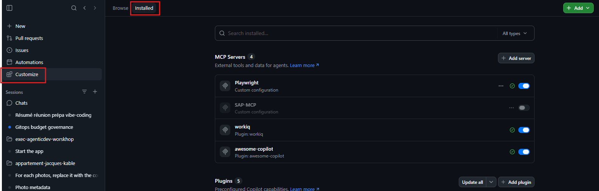
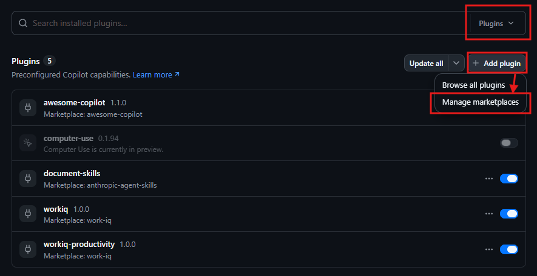
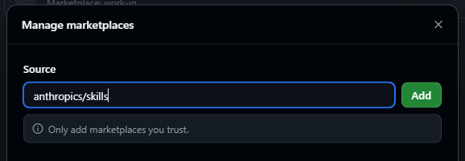
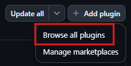
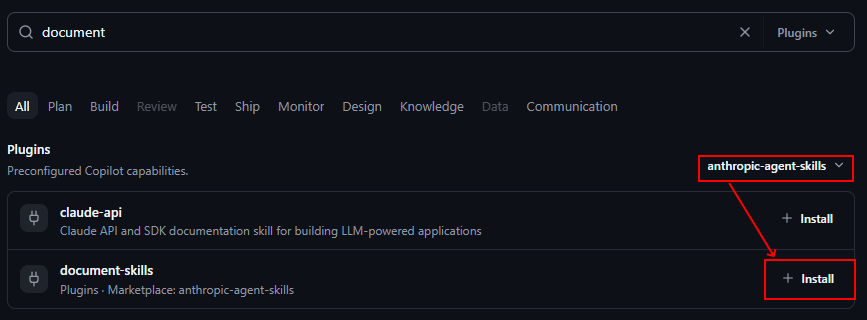

# Workshop — Du besoin métier au dashboard avec Copilot App

Vous gérez une boutique d'albums de musique. Vous disposez de deux années de données de vente, mais l'espace administrateur les affiche uniquement sous forme de données brutes.

**Votre mission :** utiliser GitHub Copilot dans Copilot App pour transformer ces données en un dashboard utile, puis préparer une présentation PowerPoint de vos analyses.

## Avant de commencer

- Disposer de Copilot App, avec GitHub Copilot connecté et utilisable.
- Installer [Bun 1.4.4](https://bun.com/docs/installation) (version utilisée pour le workshop), puis redémarrer Copilot App si nécessaire pour rendre la commande `bun` disponible. Node.js et npm ne sont pas nécessaires pour cette application.
- Récupérer ce dépôt et ouvrir son dossier dans Copilot App.
- Ouvrir le [transcript de réunion fictif](transcript-reunion-dashboard.txt) inclus dans le dépôt.

L'application fonctionne en local, sans backend ni service cloud. Les données sont fictives et les visuels sont inclus dans le projet. Une connexion Internet est nécessaire pour installer les dépendances et utiliser Copilot.

## Découverte — Lancer l'application avec un prompt

Dans Copilot App, demandez simplement :

> Lance cette application en local avec Bun, sans Node.js ni npm. Installe les dépendances avec `bun install --frozen-lockfile` si nécessaire, démarre le serveur avec `bun run dev` et donne-moi l'adresse à ouvrir dans mon navigateur.

Ouvrez l'adresse indiquée, normalement **http://localhost:3001**, puis :

1. Parcourez la boutique et ses albums.
2. Cliquez sur **Admin login** pour ouvrir l'espace administrateur.
3. Explorez les collections avec **Data collection** et les boutons **Previous / Next**.

Vous pouvez consulter les albums, les magasins et la boutique en ligne, les clients fictifs, les événements saisonniers et les commandes. Le jeu de données couvre **2024 et 2025** : 30 albums, 10 magasins physiques, une boutique en ligne, 600 clients et 9 937 commandes.

Le mode administrateur est une simulation : aucun identifiant n'est demandé. **Logout** permet de revenir à la boutique.

*Capture à ajouter : l'application et les données brutes en mode administrateur.*

## Étape 1 — Construire votre dashboard de ventes

### Partir du besoin métier

Le [transcript de réunion fictif](transcript-reunion-dashboard.txt) contient le contexte et les attentes métier. **Il remplace l'accès à Work IQ pour cet exercice.** Référencez ce fichier dans votre conversation dans Copilot App ou joignez-le.

Commencez, par exemple, avec ce prompt, **en mode plan**, en référençant le fichier fourni :

> Lis le transcript de réunion joint et explore les données de vente du projet. Résume les besoins métier, identifie les indicateurs que les données permettent de calculer et propose une première version simple du dashboard. Signale les demandes auxquelles les données ne permettent pas de répondre. Ne modifie pas encore le code.

Réponsez aux questions, et prenez le temps de revoir et ajuster le plan. Puis demandez à Copilot de passer à l'action :

> Implémente ce dashboard dans l'espace administrateur, en t'appuyant sur les besoins du transcript et les données existantes. Garde l'application en Vue 3 / TypeScript, entièrement frontend et locale, et préserve la boutique. Vérifie les calculs, puis exécute les tests et le build.

### Explorer et améliorer

Testez le résultat dans le navigateur et faites évoluer votre dashboard avec vos propres prompts. Quelques pistes, à adapter au transcript :

- Suivre les ventes, le nombre de commandes et le panier moyen.
- Comparer les magasins physiques et la boutique en ligne.
- Identifier les albums les plus vendus et l'évolution mensuelle des ventes.
- Explorer la saisonnalité et les lancements d'albums.
- Filtrer les résultats par période, canal ou magasin.

**Vérifiez les chiffres, pas seulement le rendu.** Les montants des lignes de commande sont en centimes USD : les ventes se calculent avec la quantité multipliée par le prix unitaire historique. Les données ne permettent pas de calculer une marge et une corrélation saisonnière ne prouve pas une causalité.

**Résultat attendu :** un dashboard fonctionnel qui répond aux principales questions de la réunion, avec des chiffres vérifiés et quelques enseignements que vous pouvez expliquer.


## Étape 2 — Générer une présentation PowerPoint

Vous allez maintenant utiliser le skill PowerPoint **`pptx` d'Anthropic** pour présenter vos résultats.

Le skill peut nécessiter des outils supplémentaires selon son mode d'exécution. L'absence de prérequis Node.js concerne l'application Vue, pas nécessairement les outils de génération PowerPoint.

### Installer le skill dans Copilot App

1. Ouvrez la section Customize dans Copilot App. C'est ici que vous pourrez installer, et activer les skills, MCP Servers, plugins et autres extensions pour Copilot.

2. Dans les apps installées, recherchez la section des plugins et cliquez sur `Add Plugin` puis `Manage Markeplace`.

Un marketplace est un catalogue permettant de distribuer des plugins et des skills pour Copilot. Vous pouvez construire vos propres catalogues d'entreprise ou utiliser ceux proposés par la communauté.
3. Nous allons ajouter le marketplace **Anthropics Skills** proposé par Anthropic.
Dans le champ **Source** saisissez la valeur `anthropics/skills` et cliquez sur **Add**

4. De retour sur l'écran des plugins, recherchez le skill qui nous intéresse: **`document-skills`**, puis installez-le.




### Préparer votre restitution

Dans Copilot App, demandez par exemple :

> Utilise le skill pptx d'Anthropic pour créer un document PowerPoint de 5 diapositives pour faire une présentation exécutive des nouvelles fonctionnalités. Utilise le transcript et les données des sessions copilot sur ce projet. Les 4 premiers slides doivent couvrir le contexte, les objectifs, les nouvelles fonctionnalités et les impacts attendus et le dernier slide doit doit être un rapport visuel du cout, des sessions, des modèles et de la consommation de tokens des sessions qui ont été nécessaires. Utilise le MCP Playwright pour ajouter des captures d'écran. Enregistre le fichier .pptx dans le projet et indique son emplacement.

Ouvrez le fichier généré, vérifiez le contenu et la lisibilité des diapositives, puis demandez les ajustements nécessaires à Copilot.

**Résultat attendu :** une présentation PowerPoint courte et exploitable pour restituer vos conclusions.


## Repères utiles

- [Données de vente](src/data/sales.json) et [contrats TypeScript](src/types/sales.ts).
- [Vue administrateur à faire évoluer](src/components/AdminDataView.vue).
- [Service de persistance des albums](src/services/albumStorage.ts) et [contrat Album](src/types/album.ts) à réutiliser si nécessaire. Préservez les données localStorage existantes et affichez explicitement les erreurs de lecture, de validation ou d'écriture.

Pour un lancement manuel :

```shell
bun install --frozen-lockfile
bun run dev
```

Après vos modifications : `bun run test` et `bun run build`. Pour vérifier les types uniquement : `bun run type-check`. Pour vérifier le jeu de données : `bun run data:check` ; pour le régénérer : `bun run data:generate`.

Les tests utilisent Vitest : utilisez **`bun run test`**, pas `bun test` (qui lance le test runner intégré de Bun). Les scripts imposent le runtime Bun aux outils pour éviter une dépendance implicite à Node.js. Le fichier `bun.lock` versionné fixe les dépendances ; utilisez `bun install --frozen-lockfile` pour le respecter.

Application adaptée du frontend Vue de [Philess/gh-copilot-demo](https://github.com/Philess/gh-copilot-demo).
